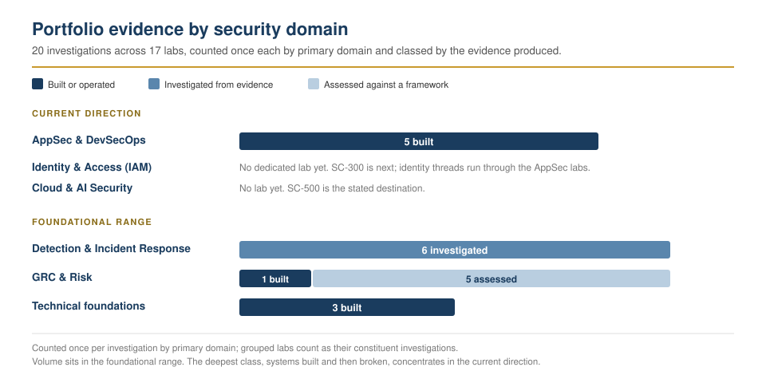

# Cybersecurity Portfolio

The case-study record of my application security work. I am a software engineer: I build web products, then test them before anyone relies on them. This repository holds the hands-on labs, incident analyses, and engineering-security projects behind that work, each documented with its evidence. The reproducible lab guides and the writing live on my site, [lawaloyinlola.com/security](https://lawaloyinlola.com/security).

---

## 👤 About Me

I am a full-stack software engineer and team lead with three years of building and shipping production systems for fintech, GPS/IoT, and AI platforms, after two years in IT operations. I lead a six-person engineering and IT team, and I work in application security and DevSecOps from the builder's side. My strength is that I understand how software is built, and that is what lets me find where it breaks and fix it. I focus on proactive security: secure code, hardened CI/CD pipelines, runtime defences that are measured rather than assumed, and strong identity and access controls. My long-term direction is cloud and AI security. My software background is not a separate past life; it is the foundation I build security on.

The rules I hold every lab to: I only test what I own or have written permission to test, I stay inside the agreed scope, and every test ends in a written report that says what I found, why it matters, and how to fix it.

---

## 🛡️ Technical Skills & Tooling

### 🔐 Application & Cloud Security (In Progress)

- **Application Security:** OWASP Top 10, secure code review, dependency and vulnerability management, threat modeling, WAF tuning and virtual patching
- **DevSecOps:** CI/CD security pipelines, SAST and DAST, secrets scanning, GitHub Actions
- **Identity & Cloud:** IAM concepts, authentication mechanics (OAuth2/OIDC, tokens, sessions), Microsoft Entra ID, Azure security fundamentals
- **Offensive testing & detection:** penetration testing in my own lab, SIEM and intrusion detection, detection rules mapped to MITRE ATT&CK
- **Foundations:** Threat and incident analysis, NIST CSF, risk assessment, Linux CLI, SQL, core network protocols (TCP/IP, DNS, HTTP/S)

### 🧰 Security Tooling

- **Build time:** Semgrep, Trivy, Gitleaks, Dependabot, GitHub Actions, OWASP ZAP
- **Runtime:** ModSecurity, OWASP Core Rule Set, NGINX, Docker
- **Offensive:** Kali Linux, nmap, OpenVAS/GVM, Metasploit, Hydra, John the Ripper, GoPhish
- **Detection:** Wazuh, Suricata, VirusTotal, tcpdump and Wireshark (traffic analysis)

### 💻 Software Engineering Foundation

I build full-stack, and that is the foundation I build security on: I can follow a feature through every layer it touches and secure it there, rather than review it from the outside.

- **Full-stack delivery:** React / Next.js frontends, Node.js / NestJS + Prisma APIs, and the NGINX edge that fronts them. This is the same stack I attack and defend in the [CI/CD](./labs/cicd-security-pipeline/analysis.md) and [WAF](./labs/waf-runtime-defence/analysis.md) labs.
- **Domains:** real-time GPS / location ingestion and IoT device telemetry, and payment flows in a production fintech environment.
- **Securing code end to end:** input validation and object-level authorisation in the API, output encoding in the UI, and TLS, security headers, and runtime controls (ModSecurity / CRS) at the edge.
- **Web architecture:** frontend system design, secure application logic, web performance.
- **Languages:** JavaScript, TypeScript, HTML5/CSS3; SQL, Python, and Bash for scripting.

---

## 🧪 Projects, Labs & Case Studies

Documented using the **CAR (Context, Action, Result)** framework, grouped by theme. Each individual investigation's write-up lives in its own `analysis.md`; grouped labs (multiple investigations under one theme) are indexed by a `README.md` that links out to each. The step-by-step guides for the labs I built myself are published on the site, and the [interactive labs map](https://lawaloyinlola.com/security/labs) shows how they connect.

<picture>
  <source media="(prefers-color-scheme: dark)" srcset="./assets/evidence-map-dark.svg">
  
</picture>

### 🚀 Application Security Engineering

The core of my work: securing real software and its delivery pipeline.

- **[CI/CD Security Pipeline](./labs/cicd-security-pipeline/analysis.md)** _(featured)_: Policy-driven SAST, dependency, container, and secrets scanning added to a live, self-hosted SaaS product via GitHub Actions, with every finding individually triaged (fixed, accepted, or false-positive with reasoning) and a fail-open defect in the pipeline's own deploy gate found and fixed after the fact. Published: [live writeup](https://lawaloyinlola.com/security/labs/cicd-security-pipeline).
- **[Runtime Defence with a WAF](./labs/waf-runtime-defence/analysis.md)** _(featured)_: ModSecurity and the OWASP Core Rule Set put in front of the same production application as the pipeline above, attacked across six payload classes against a no-WAF control, and measured. Blocked 12 of 26 payloads, every one already handled by the framework; the class that decides real breaches, broken object-level authorisation, passed through untouched, as it must, and was stopped by the application's own tenant isolation instead. Found a rule-placement bypass, and tuned the one false positive that mattered (the Core Rule Set blocking PATCH and DELETE on a REST API) with a single documented exclusion rather than by lowering paranoia. Concludes on the WAF as a compensating control that buys response time, not a fix. Published: [blog](https://lawaloyinlola.com/blog/what-my-waf-actually-blocked) · [LinkedIn briefing](https://lnkd.in/p/d_SXgSJ3). The same measurement on OWASP Juice Shop, with a rig you can run, is a guided lab: [the rig](./labs/waf-runtime-defence/rig/) and [the guide](https://lawaloyinlola.com/security/labs/waf-runtime-defence).
- **[Full Compromise on Apple Silicon (Pentest Lab)](./labs/apple-silicon-pentest-lab/analysis.md)**: A complete penetration test built on an M-series Mac, solving the ARM-vs-x86 problem most guides ignore: UTM virtualises an ARM Kali for speed and emulates an x86 Metasploitable 2 target. The target is taken to root two independent ways, to contrast a patient human attack with a single unpatched service: a slow, realistic manual credential chain (Hydra → SSH → three privilege-escalation routes → persistence → offline hash cracking → log clearing), and a one-shot Metasploit backdoor (CVE-2011-2523). Every offensive step is paired with its defensive control and distilled into an executive-readable findings report in which the seven findings resolve to one root cause: an unsupported, unpatched operating system. The shared environment it runs on is its own guide, the [Foundation lab](https://lawaloyinlola.com/security/labs/apple-silicon-lab-foundation). Published: [blog](https://lawaloyinlola.com/blog/building-a-pentest-lab-on-apple-silicon) · [live writeup](https://lawaloyinlola.com/security/labs/building-a-pentest-lab-on-apple-silicon) · [report PDF](https://lawaloyinlola.com/files/apple-silicon-pentest-lab-report.pdf) · [LinkedIn briefing](https://lnkd.in/p/dWJJqyUw).
- **[Auditing Automated Malware Response (Wazuh + VirusTotal)](./labs/wazuh-virustotal-response/analysis.md)**: A self-built detection, enrichment, and auto-remediation pipeline that produced a complete and convincing alert chain for a full day while deleting nothing, surfaced only by checking the filesystem by hand. The response step is not a configuration toggle but a shell script running as root against operator-uncontrolled input: the audit found an unverified dependency masked by an unconditional `exit 0`, no logging on any path, and an unvalidated path passed straight to `rm -f`. Rewritten with dependency checks, path confinement, deletion verification, and an audit trail, then re-tested in both directions. Published: [live writeup](https://lawaloyinlola.com/security/labs/detection-siem-lab).
- **[PASTA Threat Model (Sneaker Marketplace App)](./labs/pasta-threat-model/analysis.md)**: Seven-stage application threat model of a payment-handling mobile app, tracing prioritized technology scope through a data flow diagram and attack tree to two vulnerabilities (SQL injection, session hijacking) and the four controls that each close a specific attack path.

### 🔎 Incident Analysis

- **[Phishing Bridge (Run a Campaign, Then Detect It)](./labs/phishing-simulation-lab/analysis.md)**: A purple-team exercise on the same Apple Silicon network as the pentest, running one phishing click end to end and watching it from both seats. A campaign and a local catch-all mail server run on the attacker box, and a second VM opens the lure so the click crosses the network from the victim's own address. The defensive half is the real work: the framework's access log is not JSON and no built-in Wazuh decoder recognises it, so a custom PCRE2 decoder was written to extract the source, method, path, and record id, then three rules mapped to MITRE ATT&CK T1566 fire on the open, the visit, and the submission. A detection resting on an undecoded log fails silently, so each rule is proven against a known log line before the dashboard is trusted. No real mail is sent, every target is an invented `.local` address, and password capture stays off. Published: [live guide](https://lawaloyinlola.com/security/labs/phishing-simulation-lab).
- **[ADT Home Security Data Breach](./labs/incident-response-adt/analysis.md)**: Architectural breakdown of the April 2026 voice phishing (vishing) intrusion, its impact on SSO identity controls, and customer PII remediation.
- **[Network Traffic & Incident Analysis](./labs/network-traffic-analysis/)**: Four grouped investigations: packet-capture analysis of a DNS service outage, a SYN flood denial of service, and a brute-force attack with malware redirect, plus a full NIST CSF analysis of an ICMP flood, each tracing evidence to root cause and remediation.
- **[Phishing Incident Response (Playbook Triage & IoC Analysis)](./labs/phishing-incident-response/analysis.md)**: Level-one SOC triage of a phishing alert (ticket A-2703) worked through a defined playbook to an auditable escalate decision, then VirusTotal IoC analysis of the malicious attachment mapped onto the Pyramid of Pain and MITRE ATT&CK. One intrusion, traced from alert to durable detection.
- **[Incident Handler's Journal](./labs/incident-handler-journal/incident-handlers-journal.md)**: A running nine-entry journal spanning the certificate work: two 5 W's incident investigations (ransomware, phishing) and six hands-on cybersecurity-tool entries (Wireshark, tcpdump, VirusTotal, Suricata, Splunk, and Chronicle), closed by a reflection on the learning journey.

### 📋 Governance, Risk & Compliance

- **[Internal Security Audit (Botium Toys)](./labs/internal-audit-botium-toys/analysis.md)**: Controls and compliance assessment of a fictional retailer against NIST CSF, PCI DSS, GDPR, and SOC, mapping a narrative risk assessment to named frameworks and producing a prioritized remediation roadmap.
- **[Network Hardening Assessment](./labs/network-hardening-assessment/analysis.md)**: Post-breach security risk assessment mapping four network vulnerabilities to a minimal set of hardening controls (MFA, password policies, port filtering), chosen by coverage rather than one tool per finding.
- **[Network Segmentation & Least Privilege (Hospital Network)](./labs/network-segmentation-least-privilege/analysis.md)**: Hands-on Cisco Packet Tracer build of a two-department hospital network, hardened past its connectivity brief with a directional router ACL (doctors reach the pharmacy; the pharmacy cannot initiate into patient-record hosts), switch port security, and SSH-only management, verified by ping asymmetry and live ACL hit counters.
- **[Vulnerability Assessment (Public E-commerce Database)](./labs/vulnerability-assessment-ecommerce-db/analysis.md)**: Qualitative NIST SP 800-30 Rev. 1 risk assessment of a MySQL server left publicly exposed for three years, scoring three threat source/event pairs on likelihood × severity and mapping the ranked risks to a root-cause, defense-in-depth control set.
- **[Access Control & Least Privilege](./labs/access-control-least-privilege/)**: Two grouped investigations: a data-leak incident from over-broad folder sharing, and a fraudulent payroll entry traced to a contractor account never deprovisioned, mapped to NIST SP 800-53 AC-6, AC-2, PS-4, and PS-5.

### 🧪 Technical Skills Labs

- **[Linux File Permissions](./labs/linux-file-permissions/analysis.md)**: Auditing and modifying file and directory authorization using `chmod` and `ls -la`, including interpretation of the permission string.
- **[SQL Filtering for Investigations](./labs/sql-query-filtering/analysis.md)**: Using `AND`, `OR`, `NOT`, `LIKE`, and date and time filters to investigate login activity and asset data.
- **[Python Algorithm for File Updates](./labs/python-file-updates/analysis.md)**: Automating allow list maintenance for a restricted patient-records subnetwork: a read → transform → write script using `with`/`open()`, `.read()`/`.write()`, `.split()`/`.join()`, a `for` loop, and membership-guarded `.remove()`.

### 🗺️ Planned

The labs map on the site lists these as planned. Each one gets an entry here when it is published.

- **AI assistant:** inject an AI feature, then contain it. This is the third AppSec lab, after the pipeline and the WAF.
- **AI-augmented SOC:** dashboards, network inventory, and AI-assisted triage on top of the detection stack.
- **Azure:** a cloud foundation (tenant and logging), then securing a RAG application.

---

## ✍️ Writing

Security posts from [the blog](https://lawaloyinlola.com/blog), newest first. Each post is also syndicated to [dev.to](https://dev.to/lawaloyinlola).

- **[The three questions you get asked at 2am](https://lawaloyinlola.com/blog/the-three-questions-at-2am)**: Why application logs are not an audit trail, and five questions a non-technical leader can ask about it.
- **[Your coding agent runs as you. So does everything you install into it.](https://lawaloyinlola.com/blog/the-skill-you-installed)**: Why the artefact you review and the instruction that runs are two different objects, and how to inventory what a coding agent can reach.
- **[Prompt injection is an authority problem, not a wording problem](https://lawaloyinlola.com/blog/prompt-injection-is-an-authority-problem)**: The architectural defence: the model never holds authority, and every tool call is re-checked against the user's own permissions.
- **[A pentest lab on Apple Silicon (and what a frontend dev did with root)](https://lawaloyinlola.com/blog/building-a-pentest-lab-on-apple-silicon)**: The one insight that makes an M-series Mac work as a pentest lab, and the seven phases of a pentest walked end to end.
- **[A security checklist my coding agent has to run](https://lawaloyinlola.com/blog/security-checklist-my-agent-runs)**: Every checklist item rewritten as something you run, and packaged as a skill a coding agent loads before it writes the code.
- **[What my WAF actually blocked, and what my app already stops on its own](https://lawaloyinlola.com/blog/what-my-waf-actually-blocked)**: 26 payloads against a production app with ModSecurity on and off, and the class behind most real breaches that neither column showed.
- **[Ethical hacking is not a toolset, it is a mindset with a permission slip](https://lawaloyinlola.com/blog/ethical-hacking-is-not-a-toolset)**: Hacker, ethical hacker and penetration tester are not the same thing; the mindset, the seven-stage method, and black, grey and white box testing.

---

## 📜 Certifications & Education

### 🔒 Security Certifications

- **Google Cybersecurity Professional Certificate**: Completed (Coursera) · [Verify credential](https://coursera.org/verify/professional-cert/PZZDNMRKGNAL) · [Credly badge](https://www.credly.com/badges/99d514e9-c306-4f55-95db-efd37a099b53/public_url)
- **CompTIA Security+**: Target 2026 (foundational baseline)
- **Microsoft SC-300, Identity & Access Administrator**: Planned
- **Microsoft SC-500, Cloud & AI Security Engineer**: Planned (destination)

### 🎓 Education

- **Higher Diploma in Science in Computing (NFQ Level 8), Griffith College Dublin, Ireland**: February 2027 to February 2028
- **Diploma in Frontend Engineering, AltSchool Africa**: Graduated 95/100
- **Frontend Engineering Finalist, HNG Internship**

---

## 📬 Connect

- **Website:** [lawaloyinlola.com](https://lawaloyinlola.com) · [Security](https://lawaloyinlola.com/security) · [Blog](https://lawaloyinlola.com/blog)
- **LinkedIn:** [lawalOyinlola](https://www.linkedin.com/in/lawaloyinlola/)
- **GitHub:** [lawalOyinlola](https://github.com/lawalOyinlola/)
