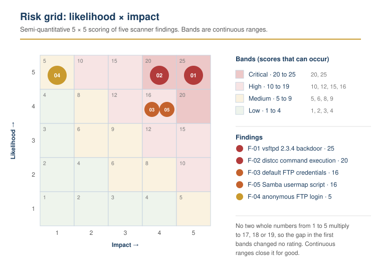
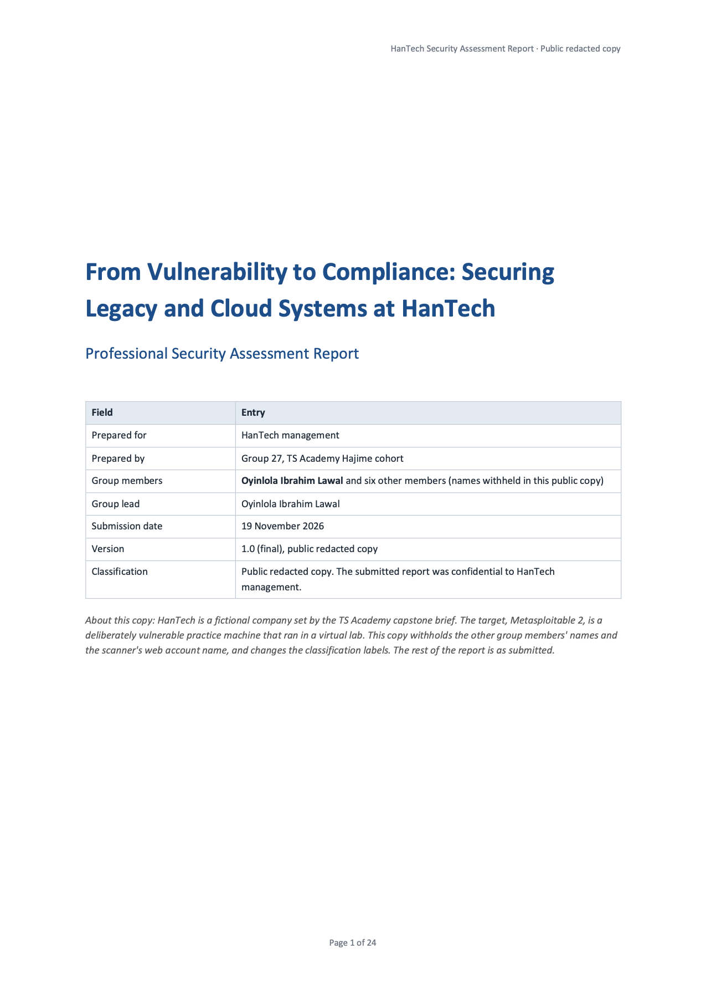

# Security assessment: from scanner findings to policy at HanTech

A group security assessment of a legacy Linux server, taken from scanner evidence
to a report that leadership can act on. I led my group through the TS Academy
capstone. I ran the scans, chose the risk method and collated the final report.
The report rates five findings, gives each one a control mapped to ISO/IEC
27001:2022, sets five policies and ends with a three-phase remediation plan.

## 📖 Context

HanTech is a fictional company set by the TS Academy capstone brief. It provides
digital platform and data services, partly in the cloud, and it found a legacy
system, Metasploitable 2, inside its environment. Management asked for an
assessment, not a break-in. They wanted to know which vulnerabilities exist, why
they are dangerous, what business risk they create, and which controls and
policies reduce that risk. The brief also asked for cloud security considerations
and a one-page executive summary for non-technical leaders.

The target was a deliberately vulnerable practice machine in my own virtual lab.
It is the same Metasploitable 2 target that I took to root in the [Apple Silicon
pentest lab](../apple-silicon-pentest-lab/analysis.md). That lab shows the
attacker's side of this machine. This case study shows the assessor's side: what
to fix first, why, and how to stop the same causes from coming back.

## ⚙️ Action

As group lead, I ran six working sessions and did each task live so that members
could repeat it. Members wrote their own drafts, I prepared a lead's draft
(AI-assisted), and I collated the final report from both.

- **Scanned and confirmed:** I ran one OpenVAS scan (GVM 25.04.0, Full and fast)
  on 5 November 2026. On 9 November 2026 I confirmed the services and versions
  with Nmap 7.99 and tested anonymous FTP login directly.
- **Selected five findings by a rule:** our own scan had to confirm each one, with
  one clear CVE and a different root cause. The five share three causes: software
  nobody updated, services left open to anyone, and logins nobody changed.
- **Chose a semi-quantitative method:** I took the group through qualitative,
  semi-quantitative and quantitative assessment, and chose a 5 × 5 likelihood ×
  impact grid. CVSS informed each score but did not decide it. The FIRST CVSS v3.1
  user guide says the base score should not be used alone to assess risk. A
  four-level qualitative matrix served as a cross-check and gave the same rating
  for all five findings.
- **Wrote the assumptions down:** the brief left HanTech's location, data, cloud
  model and network position open. We assumed a Nigerian company that holds
  personal data and uses virtual servers and storage on a public cloud. We also
  assumed no firewall in front of the host. A sensitivity line shows the effect of
  that last assumption. If only internal users could reach the host, each
  likelihood falls by one point and F-04 drops to Low.
- **Fixed a gap in our own bands:** the group noticed that the first bands gave no
  rating to 17, 18 or 19. High ran from 10 to 16 and Critical from 20 to 25. No
  two whole numbers from 1 to 5 multiply to those values, so no rating changed,
  but we rewrote the bands as continuous ranges. We rejected a fifth tier, because
  the brief asks for four levels. We also rejected equal-width bands, because they
  would have moved F-04 to Low after scoring.
- **Stayed inside the evidence:** we did no manual exploitation and did not
  connect to the backdoor's port 6200. The report says where this matters. The
  root-level impact of F-01 rests on public write-ups of the backdoor, not on our
  test. The Samba active check made the target send a ping back to the scanner,
  and the report discloses it.
- **Mapped controls and policies:** each finding got a control, a check that
  proves the control works, and its ISO/IEC 27001:2022 Annex A references. Five
  policies cover the three root causes, and every finding sits under at least two
  of them. The password policy follows NIST SP 800-63B-4 instead of the brief's
  example of regular password changes.

| ID   | Finding                          | CVE           | Likelihood | Impact | Score | Rating   |
| ---- | -------------------------------- | ------------- | ---------- | ------ | ----- | -------- |
| F-01 | vsftpd 2.3.4 backdoor            | CVE-2011-2523 | 5          | 5      | 25    | Critical |
| F-02 | distcc remote command execution  | CVE-2004-2687 | 5          | 4      | 20    | Critical |
| F-03 | Default FTP credentials          | CVE-1999-0502 | 4          | 4      | 16    | High     |
| F-05 | Samba "username map script"      | CVE-2007-2447 | 4          | 4      | 16    | High     |
| F-04 | Anonymous FTP login              | CVE-1999-0497 | 5          | 1      | 5     | Medium   |

<picture>
  <source media="(prefers-color-scheme: dark)" srcset="./risk-grid-dark.svg">
  
</picture>

## ✅ Result

The deliverable is the group's assessment report, written for HanTech's leadership
and its IT team.

- **Five findings, ranked:** two Critical, two High and one Medium. Both Critical
  findings let an outsider in without a password.
- **One control per finding:** each in priority order, with a check that proves it
  works. For F-01, the submitted check is a rescan that no longer shows vsftpd 2.3.4
  or port 6200. A rescan alone cannot tell removal from a firewall block, so the
  stronger proof is a package check that vsftpd 2.3.4 is removed or upgraded, with
  the rescan as support. The report does not say this, and I would add it.
  Controls and policies together use 11 ISO/IEC 27001:2022 Annex A controls.
- **Five policies:** Patch Management, Vulnerability Management, Access Control,
  Password and Authentication, and Secure Configuration. Vulnerability Management
  sets the deadlines: Critical within 7 days, High within 30 and Medium within 90.
  A finding that misses its deadline needs a written risk acceptance from its
  owner, with a reason and an expiry date.
- **Cloud and compliance:** under shared responsibility for virtual servers, the
  same vsftpd and Samba problems would stay HanTech's to fix in the cloud. Each
  finding maps to its cloud version, for example an open file share to a public
  storage bucket. The report names the Nigeria Data Protection Act 2023 and the
  NDPC's GAID 2025 as the rules to check. It adds the GDPR only if HanTech serves
  people in the EU. It also states that a real compliance decision needs legal
  advice.
- **A three-phase roadmap:** 7, 30 and 90 days, each phase with an owner and a
  "done when" check.
- **A one-page executive summary:** plain language, for leaders who need the
  decisions rather than the detail.

_Full deliverable: [HanTech Security Assessment Report, public redacted copy (PDF)](./hantech-security-assessment-report-redacted.pdf)_

## 🧠 What this demonstrates

This is governance and risk work built on real scan evidence rather than a written
scenario alone. It shows the chain from scanner output to a decision that
leadership can make. Select findings by a stated rule and score them with a method
you can defend. Write down the assumptions that move the ratings. Then turn each
rating into a control, a policy and a deadline.

It also shows the judgement calls along that chain. We used CVSS as an input, not
as the answer. We fixed a flaw in our own bands in the open. We kept every claim
inside what our evidence showed. Leading the group added a second skill: teach
each step live, set one standard for every draft, and collate the group's work
into one report.

Read it with the [pentest lab](../apple-silicon-pentest-lab/analysis.md) on the
same target. The lab shows how the machine falls. This report shows what to fix
first and how to keep the causes from coming back.

## 📂 Source materials

**Scenario and attribution**

The HanTech scenario and the task brief come from the TS Academy cybersecurity
capstone, "From Vulnerability to Compliance: Securing Legacy and Cloud Systems at
HanTech" (Hajime cohort). The report is the work of Group 27, which I led. The
public copy withholds the other members' names. I ran the scans that produced the
evidence. The brief and the ISO/IEC 27001:2022 standard are course and licensed
references, cited here rather than redistributed.

- **[hantech-security-assessment-report-redacted.pdf](./hantech-security-assessment-report-redacted.pdf):**
  public redacted copy of the submitted report. It withholds the other members'
  names and the scanner's web account name, and relabels the classification. The
  rest is as submitted. The scanner screenshots already hid the default
  credentials in the submitted report.
