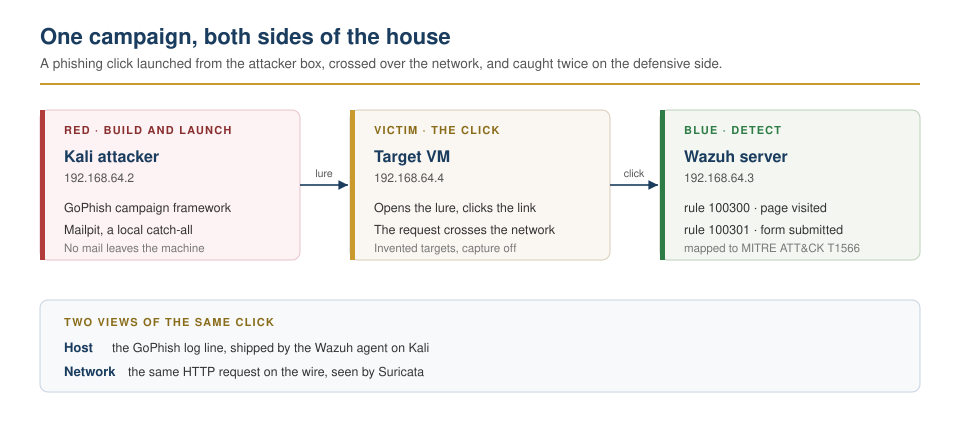

# The phishing bridge: launching a campaign and detecting the same click

A purple-team exercise that runs one phishing click end to end and watches it
from both seats: the attacker's campaign console and the defender's SIEM. The
point was not that a phishing campaign can be built, which is well understood.
It was to produce the two halves of one event from the same person, and to make
the defensive half real detection engineering rather than a dashboard that
happened to light up.

## Context

This lab sits on the same isolated Apple Silicon network as the
[pentest lab](../apple-silicon-pentest-lab/analysis.md) and reuses the Wazuh SIEM
from the [Wazuh and VirusTotal lab](../wazuh-virustotal-response/analysis.md). It
is a bridge rather than a track of its own, because it borrows the offensive
tooling from one side and the detection stack from the other. The runnable
step-by-step guide is published on the site; this writeup is the analysis and
the evidence.

The whole exercise is held inside the lab by design, and the constraints are the
lesson as much as the tooling:

- All traffic stays on the isolated network. Mail is caught locally and never
  delivered to a real inbox.
- Every target is an invented person at a `.local` domain that exists only
  inside the lab. No real person or organisation is used.
- Password capture is switched off. The exercise records that a form was
  submitted, not what was typed into it.
- The lure page is deliberately generic, named after no real organisation, so a
  screenshot published in a writeup cannot be mistaken for an impersonation of a
  real brand.

The question the lab set out to answer: when a phishing click crosses the
network, can the same click be made to appear as a correlated, attributable
detection in the SIEM, and what has to be built for that to happen?

<picture>
  <source media="(prefers-color-scheme: dark)" srcset="./phishing-bridge-dark.svg">
  
</picture>

## Action

The exercise was run in two halves against three machines on the shared network:
the attacker box, a separate victim VM, and the Wazuh server.

- **Launched a self-contained campaign.** A phishing framework and a local
  catch-all mail server ran on the attacker box, so a full campaign (sending
  profile, lure, generic landing page, invented recipient list) could be sent
  and tracked without a single message leaving the machine.

- **Drove the click from a second machine, not the attacker box.** This is the
  detail that makes the detection real. The click was issued from the victim VM
  so that the request crossed the network from the victim's own address, which
  is what lets the network sensor and the host log agree on where it came from.
  A click issued on the attacker box itself would have proved nothing about
  detection.

- **Solved the decoding problem that the campaign log actually presents.** The
  framework's access log is not JSON; each HTTP request is wrapped inside a
  log line's message field, with its inner quotes escaped. No built-in Wazuh
  decoder recognises that shape, so a rule written against it never fires and
  the SIEM silently sees nothing. The fix was a custom decoder that claims those
  lines and extracts four fields: the source address, the HTTP method, the
  request path, and the per-target record id. It uses the PCRE2 engine because
  the default regex engine cannot express the escaped-quote pattern the log
  emits.

- **Wrote detection rules against the decoded fields and mapped them to ATT&CK.**
  Three rules key off the extracted method and path: a landing-page visit (a GET
  to the root), a form submission (a POST), and an email open (the tracking
  pixel). All three carry a MITRE ATT&CK T1566 (Phishing) tag so they land in
  the technique matrix beside the detections from the other labs.

- **Proved each rule before trusting the dashboard.** A single real log line was
  fed straight into the analyser so the decode and the rule match could be
  confirmed in isolation, with every dashboard variable (indexing lag, time
  range, filters) removed. Only then was the end-to-end event generated and read
  back off the dashboard.

## Result

One click produced a correlated record on both sides of the house, from the same
operator, in one sitting.

### The detection fired, and it was attributable

The landing-page visit raised the level 10 rule and the form submission raised
the level 12 rule, both carrying the victim VM's address as the source and the
decoded method and path as fields. The same request appeared as a separate
network event from the network sensor, giving a host view (the campaign log,
shipped by the agent) and a network view (the sensor, on the wire) of a single
action. T1566 lit up in the ATT&CK matrix next to the techniques triggered in
the pentest and detection labs.

### The failure mode was the lesson, not the success

The version of this lab that simply pointed a rule at the log did not work, and
understanding why is the transferable skill. The rule never fired because
nothing had decoded the line, and the analyser reported no decoder match at all
rather than a rule that failed to match. A detection that depends on an
undecoded log is a detection that does not exist, and it fails silently: the
dashboard is simply empty, which reads identically to "nothing happened." The
decoder is what turns an opaque line into fields a rule can reason about, and it
had to be built before any rule was worth writing.

### The order of operations was the other lesson

The log collector only ships lines appended after it starts watching, so a click
generated before the agent was configured is invisible with no error anywhere.
Proving each rule against a known log line in the analyser first, before trusting
the live dashboard, is what separated "the rule is wrong" from "the event never
reached the rule." On a real estate those are different incidents with different
fixes, and the dashboard alone cannot tell them apart.

## What this lab does not prove

Stated plainly, because the alternative is overclaiming:

- **A caught click is not a caught breach.** The exercise detects the phishing
  interaction. It says nothing about what a real operator would do after a
  credential was captured, which is where the actual damage begins.
- **The rules match this framework's log shape.** They key off the access-log
  format of one tool. A different sender, or a real mail path with real headers,
  would need its own decoder. The method transfers; the regex does not.
- **Detection is not prevention.** This lab shows that a click can be seen. It
  does not stop the click, train the user, or filter the mail. Those are
  separate controls, and a SIEM alert is the last line, not the first.
- **A lab inbox is not the field.** Mail was caught locally and targets were
  invented. Nothing here was tested against a real mail provider's filtering,
  spam heuristics, or link rewriting, all of which change what reaches a user.

## Source materials

The runnable build, with the configuration and the campaign content, is kept on
the site rather than mirrored here. This folder holds what documents the method
and its evidence:

- **[analysis.md](./analysis.md):** this writeup.
- **[Published lab guide](https://lawaloyinlola.com/security/labs/phishing-simulation-lab):**
  the full step-by-step build and detection, with the screenshot evidence of one
  click seen from both sides.
- **The purple-team flow
  ([light](./phishing-bridge-light.svg), [dark](./phishing-bridge-dark.svg)):**
  the diagram above, as standalone files. The page shows whichever matches your
  theme.
