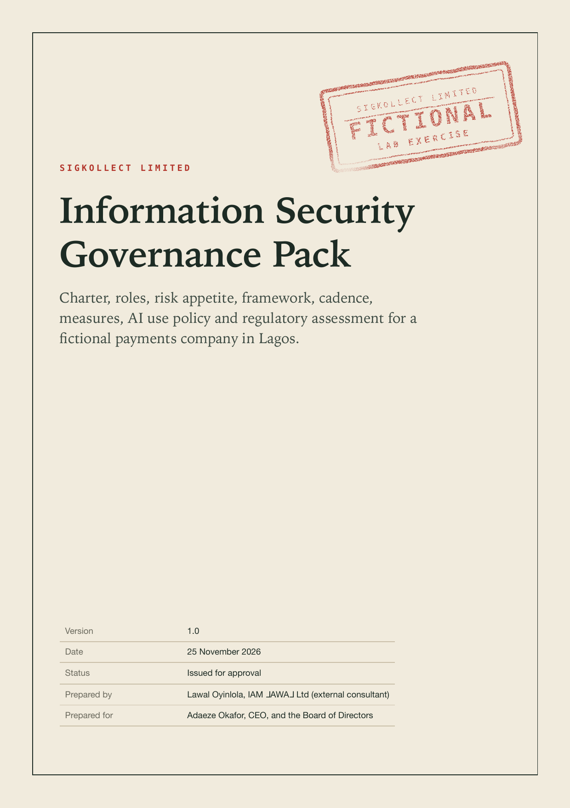

# Security governance for a fictional payments company: SigKollect

A security governance programme built from nothing for SigKollect, a fictional payments company in
Lagos with about 150 staff and merchants in Nigeria and the EU. It starts with a gap analysis and
ends with a ten-document governance pack: charter, RACI, risk appetite, framework selection,
governance cadence, KPIs, an AI use policy and a regulatory applicability assessment checked
against primary legal texts.

## ⏱️ Two-minute view

- **The situation.** SigKollect had five security events in 2026. Every one was found by chance,
  none by a control. Then a large EU merchant sent a security questionnaire the founders could not
  answer.
- **What I built.** The governance layer that was missing: who owns security, who decides what, how
  much risk the company accepts, which framework it measures itself against, when decisions are
  taken, how progress is measured, and which laws actually apply.
- **The key findings.** Seven high-priority governance gaps, led by the absence of a security lead
  and a charter. On the legal side, the primary texts overturned two assumptions from the first
  scoping: the CBN's 2024 cybersecurity framework covers banks only, and a payment gateway is a PCI
  DSS service provider, not a merchant.
- **The deliverable.** A 40-page [governance pack (PDF)](./sigkollect-governance-pack-v1.0.pdf),
  with the editable [DOCX](./source/sigkollect-governance-pack-v1.0.docx) and each document as
  Markdown in [`documents/`](./documents/).

## 📖 Context

SigKollect is invented, and so is everyone in it. I built it as a single company to run a series
of labs against, so that a finding in one lab becomes a risk in the next. It collects payments
through three products (a checkout, a small-business account and a partner API), runs on Azure,
and holds card, identity (BVN, NIN) and bank data. Revenue is about $6 million a year on about
$500 million processed, figures I derived for the scenario rather than sourced.

Its 2026 history gives the programme its evidence. Each event is backed by a lab I have already
published, as evidence that the attack and the control both work in a lab environment:

| Event | What happened | Evidence lab |
|---|---|---|
| E-1 | A forgotten server on an unsupported OS, holding payout reports | [Pentest lab](../apple-silicon-pentest-lab/analysis.md) |
| E-2 | A critical framework fix took five weeks to reach production | [CI/CD pipeline](../cicd-security-pipeline/analysis.md) |
| E-3 | SQL injection probes against the payment-link page, logs kept 14 days | [WAF lab](../waf-runtime-defence/analysis.md) |
| E-4 | A support agent entered a password on a phishing page, no MFA | [Phishing bridge](../phishing-simulation-lab/analysis.md) |
| E-5 | Nobody could say how a brute-force attack would be detected | [Wazuh detection](../wazuh-virustotal-response/analysis.md) |

I played the role of an external consultant from my company, IAM <a href="https://lawaloyinlola.com" aria-label="LAWAL">⅃AWA⅃</a> Ltd. The engagement is as
fictional as the client.

## ⚙️ Action

I ran the lab as a set of decisions, each one logged with its options, the choice and the reason.
An AI assistant set out options, drafted some documents and reviewed my work. I filled in the gap
analysis, the RACI letters, the risk appetite choices and the framework scores myself, and made
every decision in the pack.

1. **Gap analysis.** Fifteen governance areas compared with what exists today, each with evidence
   from the company profile or an event. Control gaps (no MFA, no dependency scanning, no central
   logging) were kept out and sent to the risk register, so the table stays about governance.
2. **Charter.** Authority from the board, the CEO as sponsor, and a security lead who reports to the
   CEO rather than the CTO, with a direct line to the board. The reason: the CTO owns delivery, and
   security must be able to raise risks in the CTO's area without passing them through the CTO.
   Eight dated objectives, from 28 February to 30 April 2027.
3. **RACI.** Twenty activities across twelve roles, with one accountable owner per row and
   segregation of duties checked row by row.
4. **Risk appetite.** Seven categories on a five-level scale, each with a measurable tolerance, a
   score threshold for treatment and the person allowed to accept a risk. Customer data and legal
   compliance are Averse; technology change, including AI, is Open; where a risk fits two
   categories, the lower appetite wins.
5. **Framework selection.** ISO/IEC 27001, NIST CSF 2.0 and the CIS Controls scored on eight weighted
   criteria. The totals came out within two points (41, 40, 39), so the tie-breaker was written
   down: ease of starting before certification. NIST CSF 2.0 structures the programme, CIS Controls
   IG1 is the technical baseline, and ISO/IEC 27001 certification is the later target.
6. **Governance cadence.** Four meetings, each defined by the decisions it takes, a five-slide
   quarterly board report with a written colour rule, and out-of-cycle escalation times.
7. **KPIs.** Fourteen measures, split into KPIs and KRIs, each with a target, an owner and the
   meeting that looks at it. Five reach the board.
8. **AI use policy.** Four data classes, approved tools from existing suppliers, a separate check
   and approval for each new tool, a second reviewer for AI-written code that touches payments or
   customer data, and a rule that no AI system combines private data, untrusted content and a way to
   send data out without a person approving each outgoing action.
9. **Regulatory applicability.** Seven rules assessed against their primary texts where I could find
   them, each with a result, a confidence level and a review date.
10. **The pack.** Markdown as the source, built into a PDF and a DOCX by one local script, so the
    published files can never drift from the text.

## ✅ Result

  

_Full deliverable: [SigKollect Information Security Governance Pack v1.0 (PDF)](./sigkollect-governance-pack-v1.0.pdf)_

The regulatory assessment produced the findings that matter most outside the lab:

| Rule | Result | Why |
|---|---|---|
| Nigeria Data Protection Act 2023 and GAID 2025 | Applies | The NDPC's guidance names payment gateway service providers and fintechs at its highest level, so registration, a data protection officer (s.32) and audit returns follow |
| CBN Risk-Based Cybersecurity Framework 2024 | Unclear | Its scope is commercial, merchant, non-interest and payment service banks. It replaced a 2018 framework that also named payment service providers |
| Cybercrimes Act s.21, as amended in 2024 | Likely applies | Report to ngCERT within 72 hours. Secondary sources only, and they disagree on when the clock starts |
| GDPR | Likely applies | Article 3(2) reaches a non-EU company offering services to people in the EU, and Article 27 then asks for an EU representative |
| PCI DSS v4.0.1 | Applies, by contract | A payment gateway is a service provider, so SAQ D for Service Providers or a full Report on Compliance, not a merchant SAQ |
| DORA | Not applicable | SigKollect is not an EU-authorised financial entity |

Three rules can each start a 72-hour clock on the same breach. The pack's escalation design works
back from that: a suspected breach reaches the security lead within 1 hour and the CEO and the data
protection officer within 4, so the notification decision is made well inside every deadline.

## 🔧 What I got wrong and fixed

The review rounds caught real mistakes. They are part of the result, so I list them:

- **I marked "security lead" as no gap,** because the founders had approved the role. An approved
  hire is a plan, not a control. A gap analysis records what exists today.
- **In the RACI, I made the Head of People accountable for removing leavers' access.** They have no
  authority over systems. The row was split: People is accountable for telling IT on the day, and IT
  is accountable for removing the access.
- **I first rated customer data "Eager" on the appetite scale,** reading the scale backwards. It is
  Averse.
- **In the framework scores, I gave every criterion the same weight,** which is the same as no
  weights, and scored cost and effort in the wrong direction. Fixing both turned an 18-point ISO lead
  into a near tie, which is what forced an honest tie-breaker.
- **In the cadence, the CEO heard about a data breach "within 72 hours".** That is the regulator's
  deadline, not an internal step. It is now 1 hour and 4 hours.
- **My first training rule had an exception for new joiners with assigned work.** Every new joiner
  has assigned work, so the exception would have covered everyone.

## 🧠 What this demonstrates

This is GRC work done the way a consultant would hand it over: each document traces back to
evidence and to the documents before it, the RACI agrees with the charter, the KPIs measure the
charter's objectives and the appetite's tolerances, and the policy applies the appetite. It shows
framework selection argued from a company's situation rather than from reputation, risk appetite
written as measurable tolerances, and regulatory scoping that reads the primary text and says
plainly where a lawyer is needed. It also sets up the next labs: the risk register (lab 2), identity
and access with Keycloak (lab 3), and an AI assistant that the AI use policy will be tested against.

## ⚠️ Limits

- SigKollect, its people, its figures and its history are invented. Nothing here is client work.
- The regulatory assessment is an analysis for a lab, not legal advice, and nothing in the pack
  claims compliance. The CBN question and the GDPR controller and processor roles would need a
  Nigerian payments lawyer and an EU data protection lawyer.
- The Cybercrimes Act row rests on secondary sources, because I could not find the amended text on a
  government site.
- The pack is a governance design. It has not been run: no meeting has met, no KPI has a baseline.

## 📂 Source materials

- [`sigkollect-governance-pack-v1.0.pdf`](./sigkollect-governance-pack-v1.0.pdf): the full pack.
- [`source/sigkollect-governance-pack-v1.0.docx`](./source/sigkollect-governance-pack-v1.0.docx):
  editable copy. The diagrams are in the PDF only.
- [`documents/`](./documents/): the ten documents as Markdown, with the three diagrams as SVG.
- [`CLAUDE.md`](./CLAUDE.md): the learning-mode rules I set for the AI assistant across this
  programme: it gives options and a recommendation, I decide, and each decision is logged.

The gap analysis method follows the governance gap analysis taught in my GRC course. The scenario,
the company and every document in the pack are my own.
