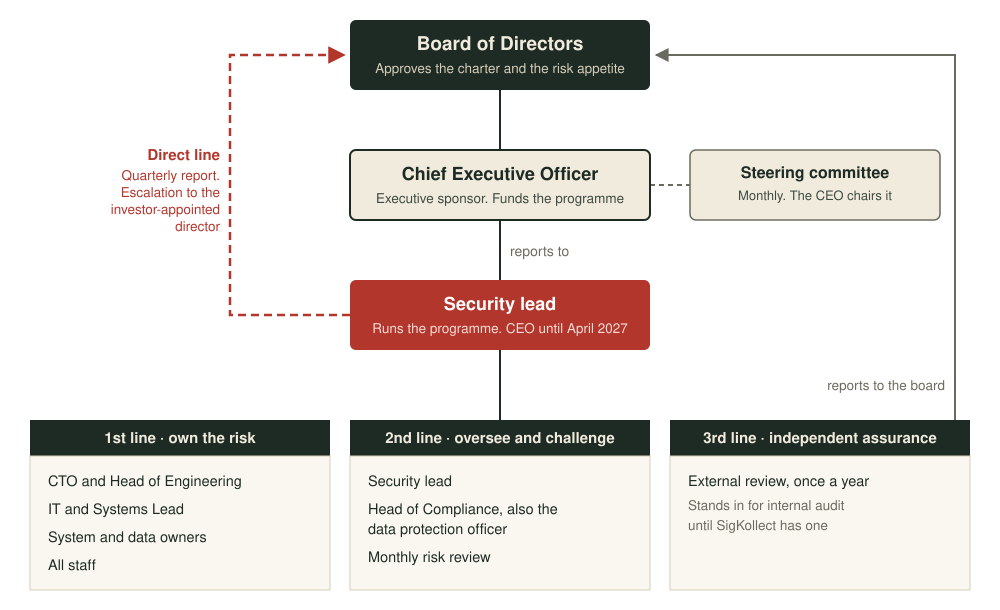

# Information security governance charter

This charter sets up the programme. It is the document every other document in this pack takes its authority from.

## 1. Purpose

This charter sets up SigKollect's information security programme. It says who is accountable for
security, how security decisions are made, and how the company manages security risk.

The programme makes sure that:

- merchant, customer and staff data stays confidential, accurate and available when it is needed;
- SigKollect meets its legal, regulatory and contractual security obligations, once they are confirmed;
- security risks are accepted or treated on purpose, by a named owner, within a limit the board
  approves;
- incidents are found, handled and reported on time;
- SigKollect can answer customers, partners and regulators with evidence.

## 2. Scope

The programme covers:

| Area | In scope |
|---|---|
| People | All employees, contractors and remote staff, and any third-party staff with access to SigKollect systems or data |
| Locations | The Lagos headquarters and every remote working location |
| Systems | The Azure environment (production and non-production), GitHub and GitHub Actions, Google Workspace, Slack, staff devices, and any legacy system still running, whether or not it is on a list today |
| Products | SigKollect Checkout, SigKollect Business and the Partner API |
| Data | Card payment data that passes through SigKollect, identity data (BVN, NIN), merchant and small-business bank details, merchant records, staff records, and system and security logs |
| Third parties | The card processor, the identity-verification provider, Microsoft Azure, GitHub, Google Workspace, Slack, and any new supplier with access to SigKollect systems or data |

Out of scope:

- **Payments regulation and anti-money-laundering compliance.** The Compliance team owns these. The
  programme works with Compliance where security and those duties meet, for example on incident
  reporting.

## 3. Authority

| Item | Value |
|---|---|
| Authorising body | Board of Directors |
| Executive sponsor | Chief Executive Officer (Adaeze Okafor) |
| Programme owner | Security lead. Until appointed: the CEO, supported by the external consultant |
| Security lead reports to | The CEO. Reason: the CTO owns delivery, and security must be able to raise risks in the CTO's area without passing them through the CTO |
| Direct line to the board | The security lead reports to the board each quarter. The security lead may also take a concern directly to the investor-appointed director when the executive team cannot resolve it. |
| Framework | NIST Cybersecurity Framework 2.0 structures the programme. CIS Controls v8.1, Implementation Group 1, is the technical baseline. ISO/IEC 27001 certification is the target once the programme runs. |

The board approves this charter, the risk appetite and any risk acceptance above the appetite. The
executive sponsor funds the programme and chairs the steering committee.

## 4. Objectives

| # | Objective | Measure | Target date | Gap it closes |
|---|---|---|---|---|
| a | Appoint a security lead | Role filled, reporting line as in section 3 | 30 April 2027 | Row 2 |
| b | Build an asset inventory | Every Azure subscription, SaaS tool and server listed, each with a named owner | 31 March 2027 | Row 14, E-1 |
| c | Approve the core policies | Information security, access control, acceptable use and incident response policies approved | 30 April 2027 | Row 4 |
| d | Adopt an incident response plan | Plan approved, with reporting routes to the NDPC, ngCERT, the CBN and EU authorities, and tested in one tabletop exercise | 30 April 2027 | Row 13, E-4 |
| e | Review access to every system with customer or payment data | First review complete. Every leaver account found is removed within 5 working days | 30 April 2027 | Row 11 |
| f | Approve a risk appetite and the first risk register | Appetite approved by the board. Register holds every finding from E-1 to E-5 | 31 March 2027 | Row 5 |
| g | Answer the EU merchant's questionnaire | Every answer backed by evidence, or stated as a known gap with a date | 28 February 2027 | The trigger |
| h | Meet the data protection registration duties | Registered with the NDPC as a data controller of major importance. Data protection officer designated. First Compliance Audit Return filed | 31 March 2027 | Regulatory assessment, R-1 |

## 5. Roles and responsibilities

| Role | Responsibility |
|---|---|
| Board of Directors | Approves the charter and the risk appetite. Receives the quarterly security report. Approves risk acceptance above the appetite |
| Chief Executive Officer | Executive sponsor. Funds the programme. Chairs the steering committee |
| Security steering committee | CEO (chair), CTO, COO, CFO, security lead, Head of Compliance. Meets monthly. Sets priorities, approves policies, tracks the objectives |
| Security lead | Runs the programme. Owns the policies, the risk register and the security reports. Advises, monitors and challenges the first line |
| CTO and Head of Engineering | Build and run systems securely: patching, secure delivery, pipeline controls. First line of defence for technology |
| IT and Systems Lead | Creates and removes accounts. Keeps the asset inventory current. Manages staff devices |
| Head of People | Tells IT about every joiner, mover and leaver on the day of the change |
| Head of Compliance | Payments regulation and anti-money-laundering. Data protection officer under the NDPA (section 32), supported by an external data protection adviser |
| Head of Sales and Partnerships | Routes customer security requests to the security lead, and sends the approved answers |
| System and data owners | One named owner for each system and data set. Approves access to it. Prepares and records risk acceptances on it. The approver the risk appetite names accepts them |
| All staff | Follow the policies. Report suspected incidents at once, without fear of blame |
| Independent review | An external review of the programme once a year, until SigKollect has internal audit. |

## 6. Principles

1. **Decisions rest on evidence.** A control counts only when there is proof that it works.
2. **Everything has an owner.** Each system, data set and risk has one named owner.
3. **Least privilege.** People and systems get the access they need, for as long as they need it.
4. **Risk is accepted on purpose.** Only a person with the authority can accept a risk, and the
   acceptance is written down. Within the appetite, that is the person the risk appetite names. Above
   the appetite, only the board can accept it (section 3).
5. **Report early, without blame.** A fast report is worth more than a perfect one. E-4 was contained
   because one agent reported it.

## 7. Review and change

The steering committee reviews this charter once a year. It reviews the charter earlier when:

- the security lead is appointed;
- SigKollect launches a product or enters a new market;
- a serious incident happens;
- a regulation that applies to SigKollect changes;
- a supplier that holds SigKollect data changes.

The board approves every new version.

## 8. Approval

| Role | Name | Signature | Date |
|---|---|---|---|
| Chief Executive Officer | Adaeze Okafor | | |
| Board of Directors | | | |

## Annex A: high-priority gaps and where the charter answers them

| Gap (gap analysis) | Priority | Answered in |
|---|---|---|
| Row 1, governance charter | H | This document |
| Row 2, security lead | H | Section 3, objective a |
| Row 4, security policies | H | Objective c, steering committee in section 5 |
| Row 5, risk appetite | H | Objective f, board role in section 5 |
| Row 11, access reviews | H | Objective e, Head of People and system owners in section 5, principle 3 |
| Row 13, incident response plan | H | Objective d, principle 5 |
| Row 14, asset inventory | H | Objective b, IT and Systems Lead in section 5, principle 2 |
