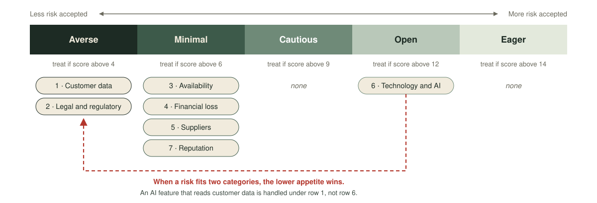

# Risk appetite statement

The board approves this statement. Every risk decision is measured against it.

## What a risk appetite is

The risk appetite says **how much risk SigKollect is willing to take** in each area, to reach its
goals. The board approves it (charter, section 5). After that, every risk decision is measured
against it:

- a risk **inside** the appetite: its owner may accept it (RACI row 4);
- a risk **above** the appetite: it must be treated, or the board must accept it (RACI row 5).

Two words to keep apart:

- **Appetite** is the general stance for a category, such as "minimal".
- **Tolerance** is the measurable line for that category, such as "no more than 4 hours of Checkout
  downtime in a month". A tolerance is what makes the appetite checkable.

## The appetite scale

| Level        | Meaning                                                                 |
| ------------ | ----------------------------------------------------------------------- |
| **Averse**   | Avoid the risk wherever possible, even at high cost or lost opportunity |
| **Minimal**  | Accept only very low risk, with strong controls                         |
| **Cautious** | Accept some risk where the benefit is clear and controls are in place   |
| **Open**     | Accept risk for a clear reward, with controls proportionate to the risk |
| **Eager**    | Seek out risk when the reward is high                                   |

## Risk scores

The risk register (lab 2) scores each risk as likelihood (1 to 5) × impact (1 to 5), from 1 to 25. The "treat if the
score is above" column uses that number. The risk register defines exactly what each likelihood and impact level
means.

| Appetite | Treat if score above | What it means in the risk register |
|---|---|---|
| Averse | 4 | Only low risks (1 to 4) may stay. Everything else is treated |
| Minimal | 6 | Low risks and the lowest medium risks may stay |
| Cautious | 9 | Medium risks may stay. High and critical risks are treated |
| Open | 12 | Most high risks are treated. Some may stay for a clear reward |
| Eager | 14 | Critical risks (15 to 25) are always treated or taken to the board |

## SigKollect risk appetite

| #   | Category                                               | Appetite | Statement | Tolerance | Treat if score above | Who may accept within the appetite |
| --- | ------------------------------------------------------ | -------- | --------- | --------- | -------------------- | ---------------------------------- |
| 1 | Customer and merchant data (identity, bank, card data) | Averse | SigKollect accepts no known exposure of identity, bank or card data. Only the smallest residual risks to this data (score 4 or below) may stay while the controls do their job. It spends money and slows delivery when that is what protecting this data takes | Zero confirmed exposures. Every system that holds this data has a named owner, MFA for every user and encryption at rest. Every suspected exposure reaches the security lead within 1 hour | 4 | The CEO only, on the security lead's advice. System owners may not accept risks in this category |
| 2 | Legal and regulatory compliance | Averse | SigKollect does not knowingly break a law, a regulation or a condition of its licence. Where a rule is unclear, it follows the stricter reading until it has advice | Zero known breaches left open. Every regulator notification sent within its legal time limit, such as 72 hours. Every regulator request answered by its deadline | 4 | Nobody may accept a known breach. A risk about how a rule applies may be accepted by the CEO, on the Head of Compliance's advice |
| 3 | Availability of the payment services | Minimal | Merchants lose sales every minute Checkout is down, so SigKollect keeps its payment services running and accepts only small, short disruptions | 30 minutes of unplanned downtime a month at most, for Checkout and the Partner API. Every outage longer than 15 minutes is reported to the CEO the same day | 6 | The CTO, who runs the platform, on the security lead's advice |
| 4 | Financial loss from security events | Minimal | SigKollect accepts only small financial losses caused by security events, such as fraud through a stolen account, refunds, fines or the cost of cleaning up an incident. Normal business spending is not part of this category | No single security event costs more than $50,000, and the total stays under $100,000 a year | 6 | The CFO, on the security lead's advice |
| 5 | Third parties and suppliers | Minimal | SigKollect depends on suppliers and cannot avoid all supplier risk, but it uses only suppliers whose security it has checked. A supplier that handles customer or card data falls under row 1 as well | Every supplier with access to SigKollect systems or data is assessed before the contract is signed and again each year. 100% of contracts with such suppliers include security and breach-notification terms | 6 | The business owner of the supplier, on the security lead's advice. For a supplier that handles customer or card data: the CEO, as in row 1 |
| 6 | Technology change and new features, including AI | Open | SigKollect grows by shipping new features and using new technology, including AI, so it accepts risk here for a clear benefit. That never overrides row 1: a change that touches customer data is held to row 1 | Every change to the payment flow or to customer data passes the security checks in the pipeline before release. Every new AI tool or AI feature is approved under the AI use policy before it is used | 12 | The CTO |
| 7 | Reputation and customer trust | Minimal | SigKollect sells trust: merchants hand it their customers' money and data. It protects that trust ahead of short-term gain | Affected merchants hear about any incident from SigKollect before they hear about it anywhere else. Every customer security questionnaire is answered within 15 working days | 6 | The CEO |

## Rules for using the appetite

**When a risk fits two categories, the lower appetite wins.** A new AI feature that reads customer
data is a row 6 risk (open) and a row 1 risk (averse). It is handled under row 1.

**Zero tolerance and the score.** Row 1 has a tolerance of zero confirmed exposures, but its
threshold is 4, not 0. A risk can never be zero: any system that holds data has some risk. "Zero" is
about the *outcome* (no leak happens). The threshold is about the *risk* (only the smallest risks
may remain while the controls do their job).

**Note for the RACI.** Row 4 of the RACI points here. The person in the "who may accept" column is
accountable for accepting a risk in that category. The system owner prepares the acceptance and
records it in the risk register, but does not approve it.

**Nobody approves their own acceptance.** If the approver named here also prepared the acceptance,
for example a supplier's business owner who is also the system owner, their line manager approves it
instead. For an executive, that is the CEO. For the CEO, it is the board. This follows RACI rule 5.