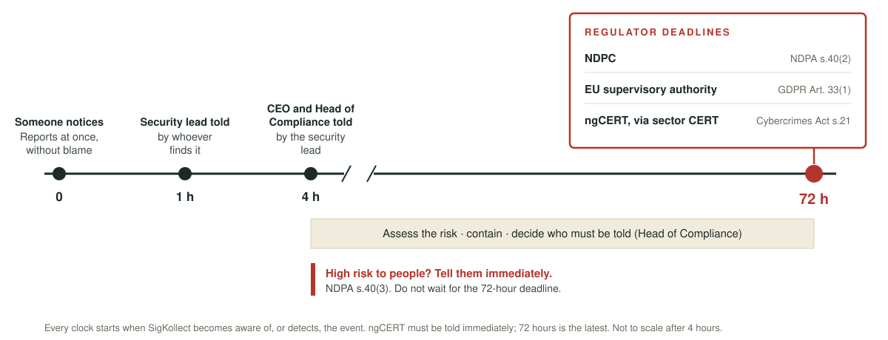

# Governance cadence and board reporting

This document sets which meetings take security decisions, what the board sees each quarter, and
which events cannot wait for the next meeting.

## Starting points

The charter and the RACI already set these. This document builds on them.

- The steering committee meets **monthly**. The CEO chairs it. Members: CTO, COO, CFO, security
  lead, Head of Compliance (charter section 5).
- The security lead reports to the **board each quarter** (charter section 3, RACI row 18).
- The access review runs **each quarter** (RACI row 11).
- Risk above the appetite goes to the **board** (charter section 3).
- Until April 2027 there is no security lead. The CEO and the consultant cover the role. Where this
  document says "security lead", read "the CEO, supported by the consultant" until then.

## Part 1: meetings

Every meeting below takes decisions. A meeting that only shares information is an email.

| Meeting | Chair | Members | How often | What it decides | Inputs | Record kept |
|---|---|---|---|---|---|---|
| Board (security item) | Board chair | The three directors. The security lead and the CEO attend to present | Quarterly | Approve the charter and its changes (RACI row 1). Approve the risk appetite (row 2). Accept or refuse a risk above the appetite (row 5) | The quarterly security report. Once a year: the external review report | Board minutes, with each decision recorded |
| Security steering committee | CEO | CTO, COO, CFO, security lead, Head of Compliance | Monthly | Approve security policies (RACI row 7). Set programme priorities and resources. Track objectives a to h. Advise on the risk appetite and on any above-appetite acceptance before they go to the board (RACI rows 2 and 5). Review the board report before it is sent (RACI row 18) | Objectives tracker, risk register summary, risks above the appetite, policy drafts, incident summaries | Minutes and an action log, kept by the security lead |
| Risk review | Security lead | CTO, Head of Compliance, and the system owners whose risks are on the agenda | Monthly, one week before the steering committee | Score new risks. Assign an owner to each risk. Agree which risks are within the appetite; the approver the risk appetite names for each category accepts them (RACI row 4). Send risks above the appetite to the steering committee | Risk register, new findings (scans, the pentest, incidents, access review results) | Updated risk register, each change dated and each acceptance signed by the approver the risk appetite names |
| Incident review | Security lead | The people who responded to the incident, and the Head of Compliance | Within 5 working days after a significant incident is closed | Agree the root cause. Assign each action an owner and a date. Decide changes to the risk register or a policy | Incident log, timeline, evidence | Post-incident report, written without blame (charter principle 5) |

Meetings not set up yet:

- **Security operations review.** Removed until the security lead is appointed. With no security
  lead, a fortnightly meeting with the CTO, Head of Engineering and IT would not happen. Patching and
  access review results go to the risk review instead. Revisit when the security lead starts.

## Part 2: the quarterly board report

The board has three directors and about 15 minutes for security.

| Field | Answer |
|---|---|
| Who prepares it | Security lead |
| Who presents it | Security lead, with the CEO present. This keeps the charter's direct line to the board (section 3). Until April 2027: the CEO, with the consultant |
| Reviewed before sending by | Security steering committee (consulted, RACI row 18). The security lead stays accountable for the report |
| Length | 5 slides |
| Sent how many days before the meeting | 5 working days |

Sections of the report, in order:

| # | Section | What it shows | Source |
|---|---|---|---|
| 1 | Summary in three lines | Overall status as one colour. The top concern. The decision the board is asked to take | The whole report |
| 2 | Progress on the charter objectives (a to h) | Where we started, where we are now, where we are going, and what we need to get there. One colour for each objective | Objectives tracker, steering committee minutes |
| 3 | Top risks against the appetite | Every risk outside the appetite, and any risk close to its limit | Risk register |
| 4 | Incidents this quarter | What happened, the effect on merchants and customers, whether each regulator notification was sent on time, and what changed | Incident log, post-incident reports |
| 5 | Decisions the board must take | Each decision, with the options and the steering committee's recommendation | Steering committee minutes |
| 6 | Regulatory and customer status | Notifications sent, regulator requests, and the status of customer questionnaires (objective g) | Head of Compliance, security lead |

Status colours:

- **Green:** on track for its target date, or inside the appetite.
- **Amber:** at risk of missing its target date by up to one month, or close to the appetite limit.
- **Red:** will miss its target date by more than one month, or outside the appetite.

## Part 3: outside the cycle

Some events cannot wait for the next meeting. "Within" is measured from the moment someone at
SigKollect first knows about the event.

| Event | Who is told | Within | By whom |
|---|---|---|---|
| Suspected personal data breach | 1. Security lead. 2. CEO and Head of Compliance | 1. 1 hour. 2. 4 hours | 1. Whoever finds it. 2. Security lead |
| Suspected cyber incident (possible ngCERT report) | 1. Security lead. 2. CEO | 1. 1 hour. 2. 4 hours | 1. Whoever finds it. 2. Security lead |
| Risk found outside the appetite | 1. CEO. 2. Board chair | 1. 1 working day. 2. 5 working days | 1. Security lead. 2. CEO |
| Outage longer than 15 minutes | CEO | 1 hour | CTO |
| A customer asks about security | Security lead | 1 working day | Head of Sales and Partnerships |
| A regulator asks about security | Head of Compliance and security lead | The same working day | Whoever receives the request |

Why these times: the NDPA and GDPR clocks (rules R-1 and R-4) run up to 72 hours from the moment
SigKollect becomes aware of a breach. The Cybercrimes Act (R-3) asks for a report to ngCERT
immediately; 72 hours from detection is the point where not reporting becomes an offence, not a
deadline to plan to. The internal steps take at most 4 hours, so the people who decide on
notification know early, and the deadlines below leave at least 24 hours before any 72-hour limit.
Risk appetite row 1 already sets 1 hour for a suspected exposure to reach
the security lead.

Notification deadlines, measured from the moment SigKollect becomes aware of, or detects, the event:

| Notification | Who decides | Decided by | Sent by |
|---|---|---|---|
| ngCERT, through the sectoral CERT or SOC (R-3) | Security lead (RACI row 15) | As soon as a detected attack, intrusion or disruption meets the s.21(1) test (liable to hinder the functioning of another computer system or network). Do not wait for the investigation to confirm it | Immediately after the decision. 24 hours after detection is the outer limit, not the deadline. Updates follow as the investigation continues |
| NDPC (R-1), and the EU supervisory authority where SigKollect is the controller (R-4) | Head of Compliance (RACI row 14) | Without undue delay, and within 24 hours of being told at most | NDPC: a first notification with the information available, without undue delay and within 48 hours at most, with the rest in phases (NDPA s.40(9)). EU supervisory authority: a first notification without undue delay once the breach is reportable, even if details are still being investigated, with the rest sent in phases (GDPR Art 33(4)), and within 48 hours at most |
| NDPC and every other relevant authority, under GAID Art 33(4) (R-1) | Head of Compliance, with the security lead | As soon as immediate information may help contain imminent breaches on a national scale, containment measures may be necessary at national, sectoral or individual level, or the breach may affect members of the general public. No finding of risk to individuals is needed first | Immediately |
| The controller that engaged SigKollect, where SigKollect is a processor (NDPA s.40(1), GDPR Art 33(2); R-1, R-4) | Head of Compliance | No separate decision: the notice is owed as soon as SigKollect becomes aware of a breach in data it processes for that controller | At once on becoming aware, with what is known, and the rest as the controller asks (NDPA s.40(1)(b)). 48 hours is the outer limit, not the deadline |
| Affected people, where the risk to them is high (R-1) | Head of Compliance, with the CEO | As soon as the risk to them is judged high | Immediately (NDPA s.40(3)) |

